# pi flow

This fork adds a pi layer on top of [addyosmani/agent-skills](https://github.com/addyosmani/agent-skills). Everything pi-specific lives in `pi/` and `package.json`. Upstream files stay untouched, so `git merge upstream/main` stays conflict-free.

## Install

Requires [pi](https://pi.dev) and the [pi-subagents](https://github.com/tintinweb/pi-subagents) extension, which runs the workflows and reviewer agents.

```bash
pi install npm:@tintinweb/pi-subagents
pi install git:github.com/aNNdii/agent-skills
```

Use `git:git@github.com:aNNdii/agent-skills` to clone over SSH instead of HTTPS. Add `-l` to install into the current project only (`.pi/settings.json`).

Remove other workflow packs that route skills on their own, so two flows don't compete:

```bash
pi remove git:github.com/obra/superpowers
```

Start a new pi session, then check:

- `pi list` shows the package.
- `/flow`, `/spec`, `/plan`, `/build`, and `/review` appear in the `/` menu.
- `/agents` lists `code-reviewer`, `security-auditor`, and `test-engineer`.

Update with `pi update`. Turn single skills or prompts on and off with `pi config`.

### Developing the pack

Install from a local clone instead. Pi loads it in place, so edits apply on the next session or `/reload`:

```bash
git clone git@github.com:aNNdii/agent-skills ~/development/agent-skills
pi install ~/development/agent-skills
```

## Flow

```mermaid
flowchart TD
    start(["/flow 'Feature X'"]):::cmd

    subgraph S1["1 · SPEC"]
        recon["Recon<br/>reads the code"]
        detect["Start check: git state<br/>linked worktree: note, used as is<br/>main checkout: ask: new worktree<br/>parent/.worktrees/repo/topic now?"]
        mode{"Goal clear?"}
        intent["Clarify intent<br/>one question per message<br/>with a guess"]
        rounds["Detail rounds: understood ·<br/>assumptions · questions with recommendation"]
        specmd[/"main/.specs/date-topic/spec.md<br/>Branch · Base · max. one page"/]:::file
        subgraph SR["Spec review · high/high · parallel"]
            l1["Builder"]
            l2["Edge cases"]
            l3["Scope"]
        end
        syn1["Synthesis ✅ ⚖️ ❓ 🗑️<br/>with examples"]
        stop1{{"STOP<br/>approve spec?"}}:::stop
        recon --> detect --> mode
        mode -->|no| intent
        intent -->|"you answer"| intent
        intent -->|"intent clear"| rounds
        mode -->|yes| rounds
        rounds -->|"you answer"| rounds
        rounds --> specmd
        specmd --> l1 & l2 & l3
        l1 & l2 & l3 --> syn1
        syn1 --> stop1
    end

    subgraph S2["2 · PLAN"]
        ground["Explorer<br/>grounding"]
        subgraph AR["Design arena · high/high · parallel"]
            d1["minimal"]
            d2["domain"]
            d3["caller"]
        end
        judge["Judge<br/>rubric · base · grafts · forks"]
        arenamd[/"arena.md"/]:::file
        conflict{"Conflict or<br/>dissent?"}
        stopD{{"STOP<br/>design decision<br/>A / B + example + recommendation"}}:::stop
        planmd[/"plan.md<br/>design · decisions · tasks"/]:::file
        stop2{{"STOP<br/>approve plan?"}}:::stop
        ground --> d1 & d2 & d3
        d1 & d2 & d3 --> judge
        judge --> arenamd --> conflict
        conflict -->|yes| stopD --> planmd
        conflict -->|no| planmd
        planmd --> stop2
    end

    subgraph S3["3 · BUILD · runs without you"]
        wt["Worktree of the spec's branch<br/>found anywhere: used as is<br/>else created in<br/>parent/.worktrees/repo/topic<br/>baseline green? (only while no task is done)"]
        task["Task Tn: fresh subagent<br/>RED → GREEN → verify"]
        gate{"Gate:<br/>Verify per task green?"}
        cp["Checkpoint commit [Tn] unsigned<br/>or git add -A + staged tree (Commits: none)<br/>+ line in build-progress"]
        retry["1 retry"]
        block{{"STOP<br/>blocker"}}:::stop
        more{"more<br/>tasks?"}
        final{"Final verify:<br/>every command green?"}
        fix["1 fix agent<br/>then Final verify again"]
        built["[final] commit or git add -A<br/>Status: built"]
        wt --> task --> gate
        gate -->|yes| cp --> more
        gate -->|no| retry --> gate
        retry -.->|"red again"| block
        more -->|yes| task
        more -->|no| final
        final -->|yes| built
        final -->|no| fix -->|green| built
        fix -.->|"red again"| block
    end

    subgraph S4["4 · REVIEW"]
        subgraph RV["Reviewer · high/high · parallel"]
            r1["code-reviewer"]
            r2["security-auditor"]
            r3["test-engineer"]
        end
        evidence["Evidence: diff + Final verify"]
        verify["Orchestrator verifies<br/>every finding itself"]
        verdict[/"review.md<br/>Act on · Consider · Noted · Dismissed<br/>+ acceptance table"/]:::file
        stop3{{"STOP<br/>pick numbers"}}:::stop
        fixes["Fixes as checkpoints [review-n]<br/>or staged, each after a green Final verify"]
        squash["Squash → one signed commit<br/>Commits: none → commit or leave staged<br/>after a commit: rebase, Final verify again"]
        stop4{{"STOP<br/>merge / push / keep"}}:::stop
        evidence --> r1 & r2 & r3
        r1 & r2 & r3 --> verify
        verify --> verdict --> stop3 --> fixes --> squash --> stop4
    end

    start --> recon
    stop1 -->|approved| ground
    stop2 -->|approved| wt
    built --> evidence

    classDef stop fill:#f9d5d3,stroke:#c0392b,stroke-width:2px,color:#000
    classDef file fill:#fff3c4,stroke:#b8860b,color:#000
    classDef cmd fill:#d6eaf8,stroke:#2471a3,stroke-width:2px,color:#000
```




| Command | Does | Stops for you |
|---|---|---|
| `/spec <request>` | Recon, then a start check of the git state (in a linked worktree only a note, the worktree is used as it is; in the main checkout the question whether to work in a new worktree now), then intent questions one at a time if the goal is unclear ("one by one" forces it), then detail rounds with recommendations, one-page spec, three-lens spec review | yes |
| `/plan [spec]` | Design arena: grounding, 2-3 competing designs (minimal, domain, caller), cross-judge, graft. Then the task plan | yes |
| `/build [plan]` | Worktree on the spec's branch: reuses it as it is, wherever it lives, else creates `<wtroot>/<topic>`. A worktree the flow did not create runs all workstreams in itself, one after another. Never builds in the main checkout. Two verify levels: `Verify per task` gates each task (one fresh subagent per task), `Final verify` runs every command once at the end, with one fix agent if red. One checkpoint commit per task, or with `Commits: none` the result stays staged. Resumes from `build-progress`. No per-task review | only on blockers |
| `/review [plan]` | Final verify, then code-reviewer, security-auditor, test-engineer in parallel on the branch diff (the staged diff with `Commits: none`). Verified, merged verdict. Fixes are taken only when Final verify is green; the finish squashes into one signed commit, or with `Commits: none` commits or leaves the result staged | yes, applies nothing |
| `/flow [request]` | Detects the phase from `.specs/` and git and runs the next one. Same stops as above | per phase |

### `.specs/` and worktrees

Spec and plan live in `<main>/.specs/<date>-<topic>/`, where `<main>` is the main checkout (the first entry of `git worktree list`). `.specs/` is excluded via `.git/info/exclude` and never committed. Without a path or topic, every phase in a linked worktree first takes the newest open item whose `Branch:` line is that worktree's branch. Otherwise it searches `<main>/.specs/` first, then `.specs/` of the current worktree. See [Find the work item](references/worktrees.md#find-the-work-item).

Feature work happens in a git worktree from the start. Worktrees live in `<wtroot>/<topic>` on `feat/<topic>` (or `fix/<topic>`), where `<wtroot>` is `<parent>/.worktrees/<repo>`: `/workspace/agent-skills` gets `/workspace/.worktrees/agent-skills/<topic>`. Nothing is nested inside the repo, so tools do not scan a second checkout.

An existing linked worktree is used as it is, whatever its path, who created it, its branch, a detached HEAD, or its changes. After recon, `/spec` then only notes where it works, and on a protected branch or a detached HEAD that `/build` cannot commit there. The spec records `Worktree: linked`. The worktree rules and questions apply only from the main checkout: there `/spec` asks whether to create the worktree now (carrying the changes along, if you want) or at `/build`. The spec records `Branch:` and `Base:`, and `/plan`, `/build` and `/review` take both from there.

The repo's parent dir must be writable and persistent. Otherwise worktree creation stops with the path and the error. Deleting a repo leaves its `<wtroot>` behind: remove that orphaned dir by hand. All rules, questions and recovery steps are in [`pi/references/worktrees.md`](references/worktrees.md), see [Parent requirements](references/worktrees.md#parent-requirements).

## Pieces

- `pi/skills/as-*`: the four phases. Invoked through `pi/prompts/*.md`.
- `pi/workflows/*.js`: deterministic fan-outs for `SubagentWorkflow` (pi-subagents). Each role has a tier (`high`, `mid`, `low`) and an effort: spec review, design, judge, and final review run high/high, grounding low/medium, implementation mid/medium, hard tasks high/high, and a retry one tier above its first attempt with high effort. The lead resolves the provider's models into `args.tiers` per `pi/references/model-tiers.md`; without it, every agent inherits the session model (only the Explore grounding agent keeps its own small model).
- `pi/references/`: model tiers (how the lead maps the provider's models to `high`, `mid`, `low`), panel synthesis (consensus, split, single, dismissed), design red flags, and language rules (talk and write specs in the user's language, keep repo text, status values, and ids in English).
- `pi/skills/principles/`: three short pstack principles, auto-loaded when they apply.
- `agents/`: the upstream personas, registered as pi subagents.

The manifest hides upstream skills that the phases replace or that would fire on every change (`using-agent-skills`, `spec-driven-development`, `planning-and-task-breakdown`, `incremental-implementation`, `interview-me`, `doubt-driven-development`, `code-review-and-quality`, `context-engineering`, `git-workflow-and-versioning`). `/spec` still reads `interview-me` by path for its intent mode. Every other upstream skill loads automatically when it applies.

## Update from upstream

```bash
git remote add upstream https://github.com/addyosmani/agent-skills.git   # once
git fetch upstream && git merge upstream/main && git push
```

Git installs pick the merge up with `pi update`.

## Credits

Design arena, red flags, review synthesis, and principles are adapted from [pstack](https://github.com/cursor/plugins/tree/main/pstack) by Lauren Tan (MIT).
