# pi flow

This fork adds a pi layer on top of [addyosmani/agent-skills](https://github.com/addyosmani/agent-skills). Everything pi-specific lives in `pi/` and `package.json`. Upstream files stay untouched, so `git merge upstream/main` stays conflict-free.

## Flow

```mermaid
flowchart TD
    start(["/flow 'Feature X'"]):::cmd

    subgraph S1["1 · SPEC"]
        recon["Recon<br/>liest den Code"]
        rounds["Runde: Verstanden · Annahmen ·<br/>Fragen mit Empfehlung"]
        specmd[/"spec.md · max. 1 Seite"/]:::file
        subgraph SR["Spec-Review · Opus medium · parallel"]
            l1["Umsetzer"]
            l2["Randfälle"]
            l3["Umfang"]
        end
        syn1["Synthese ✅ ⚖️ ❓ 🗑️<br/>mit Beispielen"]
        stop1{{"STOPP<br/>Spec freigeben?"}}:::stop
        recon --> rounds
        rounds -->|"du antwortest"| rounds
        rounds --> specmd
        specmd --> l1 & l2 & l3
        l1 & l2 & l3 --> syn1
        syn1 --> stop1
    end

    subgraph S2["2 · PLAN"]
        ground["Explorer<br/>Grounding"]
        subgraph AR["Design-Arena · Opus high · parallel"]
            d1["minimal"]
            d2["domain"]
            d3["caller"]
        end
        judge["Richter<br/>Rubrik · Basis · Übernahmen · Konflikte"]
        arenamd[/"arena.md"/]:::file
        conflict{"Konflikt oder<br/>Dissens?"}
        stopD{{"STOPP<br/>Design-Entscheidung<br/>A / B + Beispiel + Empfehlung"}}:::stop
        planmd[/"plan.md<br/>Entwurf · Entscheidungen · Tasks"/]:::file
        stop2{{"STOPP<br/>Plan freigeben?"}}:::stop
        ground --> d1 & d2 & d3
        d1 & d2 & d3 --> judge
        judge --> arenamd --> conflict
        conflict -->|ja| stopD --> planmd
        conflict -->|nein| planmd
        planmd --> stop2
    end

    subgraph S3["3 · BUILD · läuft ohne dich durch"]
        wt["Worktree + Branch feat/topic<br/>Baseline grün?"]
        task["Task Tn: frischer Subagent<br/>RED → GREEN → verify"]
        gate{"Gate:<br/>Tests grün?"}
        cp["Checkpoint-Commit [Tn]<br/>unsigniert"]
        retry["1 Retry"]
        block{{"STOPP<br/>Blocker"}}:::stop
        more{"weitere<br/>Tasks?"}
        wt --> task --> gate
        gate -->|ja| cp --> more
        gate -->|nein| retry --> gate
        retry -.->|"wieder rot"| block
        more -->|ja| task
    end

    subgraph S4["4 · REVIEW"]
        subgraph RV["Reviewer · Opus high · parallel"]
            r1["code-reviewer"]
            r2["security-auditor"]
            r3["test-engineer"]
        end
        verify["Orchestrator prüft<br/>jeden Befund selbst"]
        verdict[/"review.md<br/>Act on · Consider · Noted · Dismissed<br/>+ AK-Tabelle"/]:::file
        stop3{{"STOPP<br/>Nummern wählen"}}:::stop
        fixes["Fixes als Checkpoints [review-n]"]
        squash["Squash → 1 signierter Commit"]
        stop4{{"STOPP<br/>merge / push / behalten"}}:::stop
        r1 & r2 & r3 --> verify
        verify --> verdict --> stop3 --> fixes --> squash --> stop4
    end

    start --> recon
    stop1 -->|freigegeben| ground
    stop2 -->|freigegeben| wt
    more -->|nein| r1 & r2 & r3

    classDef stop fill:#f9d5d3,stroke:#c0392b,stroke-width:2px,color:#000
    classDef file fill:#fff3c4,stroke:#b8860b,color:#000
    classDef cmd fill:#d6eaf8,stroke:#2471a3,stroke-width:2px,color:#000
```




| Command | Does | Stops for you |
|---|---|---|
| `/spec <request>` | Recon, rounds of assumptions and questions (each with a recommendation), one-page spec, three-lens spec review | yes |
| `/plan [spec]` | Design arena: grounding, 2-3 competing designs (minimal, domain, caller), cross-judge, graft. Then the task plan | yes |
| `/build [plan]` | Worktree on `feat/<topic>`, one fresh subagent per task, verify command as gate, one commit per task. No per-task review | only on blockers |
| `/review [plan]` | code-reviewer, security-auditor, test-engineer in parallel on the branch diff. Verified, merged verdict | yes, applies nothing |
| `/flow [request]` | Detects the phase from `.specs/` and git and runs the next one. Same stops as above | per phase |

Spec and plan live in `<repo>/.specs/<date>-<topic>/` and are excluded via `.git/info/exclude`, never committed.

## Pieces

- `pi/skills/as-*`: the four phases. Invoked through `pi/prompts/*.md`.
- `pi/workflows/*.js`: deterministic fan-outs for `SubagentWorkflow` (pi-subagents). Reviewers run on Opus. Spec review uses medium effort, design, judge, and final review use high.
- `pi/references/`: panel synthesis (Konsens, Uneinig, Einzeln, Verworfen) and design red flags.
- `pi/skills/principles/`: three short pstack principles, auto-loaded when they apply.
- `agents/`: the upstream personas, registered as pi subagents.

The manifest hides upstream skills that the phases replace or that would fire on every change (`using-agent-skills`, `spec-driven-development`, `planning-and-task-breakdown`, `incremental-implementation`, `interview-me`, `doubt-driven-development`, `code-review-and-quality`, `context-engineering`, `git-workflow-and-versioning`). Every other upstream skill loads automatically when it applies.

## Update from upstream

```bash
git fetch upstream && git merge upstream/main
```

## Credits

Design arena, red flags, review synthesis, and principles are adapted from [pstack](https://github.com/cursor/plugins/tree/main/pstack) by Lauren Tan (MIT).
