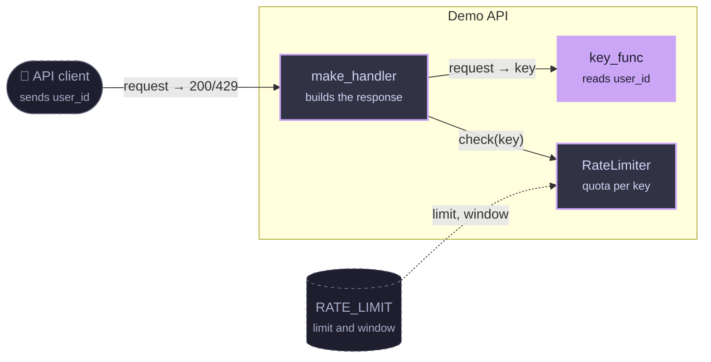

# Architecture views

Spec and plan draw the parts of the system that the change touches, after arc42 and C4: a few small diagrams that show how the program is meant to look before anyone builds it.

## Which views

| View | arc42 / C4 | Shows | Where | When |
|---|---|---|---|---|
| Context | §3 / System Context | the system as one box, the people and outside systems that use it or that it calls, and what passes between them | `spec.md`, `## System context` | the change adds or alters a user, an outside system, or an interface between them |
| Building blocks | §5 / Container or Component | the modules, services or files the change adds or alters, with the parts they talk to | `plan.md`, `## Design` | the change touches more than one module |
| Runtime | §6 / Dynamic | one important flow (a request, a job, an error path) step by step across those blocks | `plan.md`, `## Design` | a flow crosses three or more blocks, or its order matters |
| Deployment | §7 / Deployment | where it runs: processes, containers, hosts, ports, config | `plan.md`, `## Design` | the change alters how or where it runs (a new process, port, env var, volume) |

Draw only views whose "When" holds. A change inside one module gets none. Each view shows only what the change touches and its direct neighbours, at most six boxes. A view never replaces the text: the acceptance criteria, signatures and tasks stay as they are.

## How to draw

One fenced `mermaid` block per view, headed `### <view name>` in the file's language, followed by its legend line. Mermaid's own `C4Context` / `C4Container` syntax renders too small and in fixed colours, so use these shapes:

- Context, Building blocks, Deployment: `flowchart LR`, or `flowchart TB` when the longest chain has more than four boxes. People `(["👤 <name>"])`, config and stores `[(<name>)]`, the system or a host as a `subgraph`.
- Every box names its job in a second line of at most three words: `["RateLimiter<br/><small>quota per key</small>"]`.
- Every arrow carries what passes, in at most three words: `-->|"check(key)"|`. One arrow per pair of boxes, in the direction of the call, with request and answer together (`-->|"request → 200/429"|`); two arrows between the same boxes overlap their labels. Long names go in a bullet under the diagram, not on the arrow.
- Runtime: `sequenceDiagram` with the blocks as participants and `alt` for branches.
- Mark the change with these classes, copied verbatim into every flowchart (Catppuccin Mocha, accent Mauve):

  ```text
  classDef new fill:#cba6f7,color:#1e1e2e,stroke:#cba6f7
  classDef changed fill:#313244,color:#cdd6f4,stroke:#cba6f7,stroke-width:2px
  classDef ext fill:#1e1e2e,color:#a6adc8,stroke:#6c7086,stroke-dasharray:4
  ```

  `new` for added parts, `changed` for altered ones, `ext` for parts outside the system. Unmarked boxes exist and stay unchanged.
- The legend line under a flowchart names only the classes it uses, in the file's language: `Mauve fill: new · Mauve border: changed · dashed: outside`.

Example, Building blocks:



Mauve fill: new · Mauve border: changed · dashed: outside

Names in boxes are the real identifiers from the code or the spec. Check them against the code before you write them, as for signatures.
